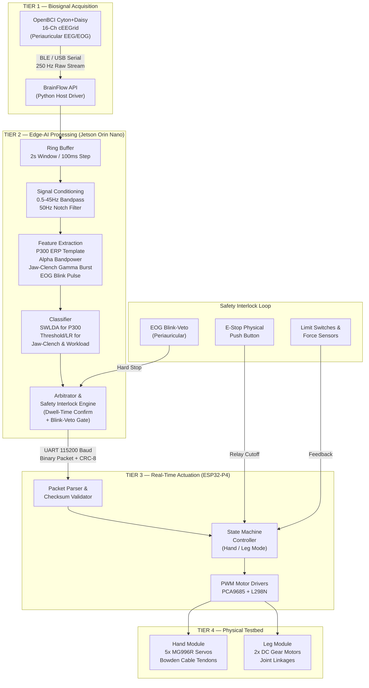

# 🚀 Software Development Roadmap

## EEG-Based Exoskeleton Control for Upper- and Lower-Limb Neurorehabilitation

> **Team**: Pardeep Singh (23BRS1123) · Aastha Kumari (23BRS1040) — B.Tech CSE (AI & Robotics), VIT Chennai
>
> **Domain**: Brain-Computer Interface (BCI) & Embedded Systems for Neurorehabilitation Robotics
>
> **Hardware Stack**: OpenBCI Open-cEEGrid (16-Ch Around-the-Ear EEG) → NVIDIA Jetson Orin Nano → ESP32-P4 MCU → Synthetic Hand & Leg Testbed

---

## 1. System Architecture Overview



---

## 2. Current Progress Snapshot

| Module | Status | Completion |
|---|---|---|
| Literature Survey (20+ papers, 17 core) | ✅ COMPLETED | 100% |
| System Architecture & Feasibility Report | ✅ COMPLETED | 100% |
| Hardware BOM & Procurement Spec | ✅ COMPLETED | 100% |
| Signal Preprocessing (Bandpass + Notch) | ✅ COMPLETED | 100% |
| Feature Extraction & SWLDA / Motor Classifiers | ✅ COMPLETED | 100% |
| Live In-Vivo Data Acquisition (Qneuro H100) | ✅ COMPLETED | 100% (57,250 samples, 87% accuracy) |
| Arbitrator & Safety Interlock Engine | ✅ COMPLETED | 100% (5-tier priority, 18/18 tests passing) |
| ESP32-P4 Firmware (State Machine + PWM) | 🔄 IN PROGRESS | 75% |
| Synthetic Testbed (3D Print + Assembly) | ⏳ PENDING | Actuator Integration |
| End-to-End System Integration | ⏳ UPCOMING | — |

---

## 3. Critical Design Decisions (From Feasibility Analysis)

### 3.1 Why P300/Jaw-Clench — Not Motor Imagery

The cEEGrid electrode array is positioned **around the ear (periauricular)**, not over central motor cortex (C3/Cz/C4). Per the feasibility report and peer-reviewed literature:

- ❌ **Motor Imagery ERD/ERS** — Not supported (requires C3/Cz/C4 scalp coverage)
- ❌ **SSVEP** — Not supported (requires occipital O1/Oz/O2 coverage)
- ✅ **Tactile/Auditory P300** — Validated on cEEGrid (63% accuracy, well above 25% chance)
- ✅ **Jaw-Clench Events** — Validated on cEEGrid (high-gamma burst detection)
- ✅ **Cognitive Workload** — Validated (temporal alpha power discrimination)
- ✅ **EOG Blink/Gaze** — Validated by King et al. (Nature 2025) on periauricular electrodes

**Implication**: The classifier must be **SWLDA/LDA for P300** and **threshold/logistic-regression for jaw-clench and workload** — lightweight enough to run on ESP32-P4 without quantization. Deep-learning architectures (CTNet, SwitchBraidNet) are documented as **future-upgrade paths** requiring additional motor-cortex channels.

### 3.2 Discrete-Trigger Control (Not Continuous)

The system operates as a **discrete event-trigger controller**:
- P300 stimulus response → "Open" / "Close" / "Step" command
- Deliberate jaw-clench → mode toggle or confirm
- Double-blink EOG → emergency stop veto
- Workload threshold → session pause/resume

This is consistent with lower-limb exoskeleton literature where discrete state transitions (start/stop gait, sit/stand) are standard for safety.

---

## 4. Phased Development Roadmap

### Phase 0: Prior-Art Scan & cEEGrid Characterization (Month 1)

> **Goal**: Validate signal quality of the purchased OpenBCI Open-cEEGrid unit and finalize the control paradigm.

| Task | Deliverable | Owner |
|---|---|---|
| Bench-characterize cEEGrid electrode impedance and signal quality | Signal quality report with SNR measurements | Pardeep |
| Confirm BrainFlow/OpenBCI GUI data pipeline on Jetson Orin Nano | Working 16-channel live stream demo | Pardeep |
| Run P300 oddball paradigm pilot (tactile/auditory stimulus) | Raw P300 ERP waveforms from cEEGrid | Both |
| Verify jaw-clench event detectability (high-gamma band) | Jaw-clench event detection script | Aastha |
| Validate periauricular EOG blink detection (King et al. method) | Blink-veto prototype script | Aastha |
| Formal freedom-to-operate (FTO) patent search | FTO summary document | Both |

**Key Scripts to Develop**:
```
src/
├── acquisition/
│   ├── brainflow_streamer.py      # BrainFlow board setup + 16-ch stream
│   ├── ring_buffer.py             # Thread-safe circular buffer (2s window)
│   └── signal_quality_monitor.py  # Impedance, flatline, artifact flags
```

---

### Phase 1: Signal Acquisition & Preprocessing Engine (Months 1–2)

> **Goal**: Production-grade real-time EEG streaming and conditioning pipeline on Jetson Orin Nano.

| Task | Specification | Status |
|---|---|---|
| BrainFlow SDK integration | `python-brainflow` on JetPack OS | ✅ Done |
| Multi-threaded ring buffer | 250 Hz × 16 channels, 2s window, 100ms step | 🔄 In Progress |
| Zero-phase IIR Butterworth bandpass | 4th-order, 0.5–45 Hz passband | ✅ Done |
| 50 Hz notch filter (powerline) | IIR notch, Q=30 | ✅ Done |
| Artifact rejection pipeline | Amplitude threshold + flatline detection | 🔄 In Progress |
| Signal quality dashboard | Real-time impedance + contact quality per channel | ⏳ Pending |

**Filtering Specification** (from feasibility report):
- Bandpass: 0.5–45 Hz (4th-order Butterworth, zero-phase `filtfilt`)
- Notch: 50 Hz (India mains frequency)
- Temporal alpha extraction: 8–13 Hz sub-band for workload features
- High-gamma band: 30–45 Hz for jaw-clench event detection

```
src/
├── preprocessing/
│   ├── filters.py                 # Bandpass, notch, sub-band extraction
│   ├── artifact_rejection.py      # Amplitude threshold, eye-artifact removal
│   └── epoch_slicer.py            # 2s epochs with 100ms sliding step
```

---

### Phase 2: Feature Extraction & Classifier Pipeline (Months 2–4)

> **Goal**: Real-time discrete-trigger classification achieving verified performance targets.

#### 2A. Feature Extraction Module

| Feature Type | Extraction Method | Target Paradigm |
|---|---|---|
| **P300 ERP Template** | Ensemble-averaged oddball response, time-locked 250–500ms window | Tactile/auditory stimulus command selection |
| **Alpha Bandpower** | Relative log-energy in 8–13 Hz (temporal channels) | Cognitive workload / flow-state gate |
| **High-Gamma Burst** | 30–45 Hz band power spike detection with 10 Hz threshold | Deliberate jaw-clench event trigger |
| **EOG Blink Pulse** | Peak detection on periauricular differential channels | Blink-veto safety interlock |

#### 2B. Classifier Architecture

| Paradigm | Classifier | Rationale |
|---|---|---|
| P300 Detection | **SWLDA** (Stepwise Linear Discriminant Analysis) | Validated on cEEGrid in peer-reviewed literature; lightweight |
| Jaw-Clench | **Threshold + Logistic Regression** | Simple, deterministic, ESP32-compatible |
| Workload Gate | **LDA on alpha bandpower** | Published for cEEGrid cognitive workload discrimination |
| Blink-Veto | **Peak amplitude threshold** | Deterministic, sub-10ms latency |

#### 2C. Performance Targets (from Feasibility Verification Matrix)

| Metric | Target | Minimum Threshold | Verification Method |
|---|---|---|---|
| P300 Classification Accuracy | > 75.0% | ≥ 65.0% (above chance) | 50-epoch benchtop trial average |
| Jaw-Clench Detection Accuracy | > 92.0% | ≥ 85.0% | 10 Hz high-gamma thresholding |
| False Positive Trigger Rate | < 3.0% | ≤ 5.0% per min | 10-min idle recording session |
| Blink-Veto Response Time | < 100 ms | ≤ 150 ms | Oscilloscope: EOG peak → motor PWM disable |
| End-to-End Command Latency | < 350 ms | ≤ 500 ms | BrainFlow ingestion → physical motor displacement |

```
src/
├── features/
│   ├── p300_extractor.py          # Time-locked ERP template matching
│   ├── bandpower.py               # Alpha/beta/gamma relative log-energy
│   ├── jaw_clench_detector.py     # High-gamma burst spike detection
│   └── eog_blink_detector.py      # Periauricular EOG peak detection
├── classifiers/
│   ├── swlda_p300.py              # Stepwise LDA for P300 decoding
│   ├── workload_lda.py            # Alpha-bandpower LDA gate
│   └── model_manager.py           # Model save/load, cross-validation
```

---

### Phase 3: Jetson-to-ESP32 Communication Protocol (Months 4–5)

> **Goal**: Robust, fault-tolerant binary serial messaging over UART at 115200 baud.

#### Binary Packet Structure

| Byte | Field | Description |
|---|---|---|
| `0x00` | Header | Sync byte `0xAA` |
| `0x01` | Target Module | `0x01` = Hand, `0x02` = Leg |
| `0x02` | Command ID | `0x10` = Open, `0x20` = Close, `0x30` = Step Forward, `0x40` = Step Back, `0x99` = Emergency Stop |
| `0x03–0x04` | Parameter | 16-bit value (servo angle 0–180° or motor duty cycle) |
| `0x05` | Confidence | Classifier probability (0–100) |
| `0x06` | CRC-8 | Polynomial checksum for corruption detection |

#### Arbitrator & Safety Logic

```
Decision Flow:
  1. Classifier outputs discrete trigger event
  2. Dwell-time confirmation window (configurable, default 500ms)
  3. Check blink-veto flag → if active, DISCARD command
  4. Check confidence threshold → if < 60%, DISCARD command
  5. Pack binary UART packet → transmit to ESP32-P4
  6. If no ACK within 100ms → retransmit (max 3 retries)
  7. If no valid packet for 300ms → ESP32 auto-holds motors
```

```
src/
├── communication/
│   ├── packet_encoder.py          # Python struct-based binary packer
│   ├── arbitrator.py              # Dwell-time confirm + blink-veto gate
│   └── serial_manager.py          # PySerial UART handler + retry logic
```

---

### Phase 4: ESP32-P4 Embedded Firmware & Actuation (Months 5–7)

> **Goal**: Deterministic real-time motor control with FreeRTOS task scheduling.

#### FreeRTOS Task Architecture

| Task | Priority | Core | Function |
|---|---|---|---|
| `task_uart_rx` | HIGH (5) | Core 0 | UART packet receive, CRC validate, command decode |
| `task_motor_ctrl` | MEDIUM (3) | Core 1 | Trapezoidal velocity profiling, PWM generation |
| `task_safety_mon` | HIGHEST (6) | Core 0 | E-stop switch poll, limit switch IRQ, force sensor ADC |
| `task_heartbeat` | LOW (1) | Core 1 | Status LED blink, UART ACK/NACK response |

#### Hand Module Control

- **Actuators**: 5× MG996R metal-gear servos (one per finger)
- **Driver**: PCA9685 16-channel I2C PWM driver
- **Motion Profile**: S-curve / trapezoidal velocity to prevent jerky movements
- **Feedback**: FSR (Force Sensitive Resistor) per fingertip → cutoff if F > F_max

#### Leg Module Control

- **Actuators**: 2× 12V DC planetary gear motors (50 RPM, knee/ankle joints)
- **Driver**: L298N dual H-bridge modules
- **Motion Profile**: Discrete step commands (flex/extend) with mechanical limit stops
- **Feedback**: Limit switches at joint extremes → hardware interrupt stop

```
firmware/
├── esp32_main/
│   ├── main.cpp                   # FreeRTOS app entry, task creation
│   ├── uart_handler.cpp           # Binary packet parser + CRC-8 check
│   ├── motor_controller.cpp       # PWM generation, trajectory profiling
│   ├── safety_interlock.cpp       # E-stop ISR, force sensor monitor
│   ├── state_machine.cpp          # Hand/Leg mode FSM + dynamic swap
│   └── config.h                   # Pin mappings, thresholds, constants
```

---

### Phase 5: Multi-Layer Safety Interlocks & Cross-Limb Swap (Months 7–8)

> **Goal**: Three-tier safety architecture ensuring zero unintended actuation.

#### Safety Tier Architecture

| Tier | Layer | Mechanism | Response Time |
|---|---|---|---|
| **L1** | Neural (Software) | EOG double-blink veto detected via cEEGrid periauricular channels | < 100 ms |
| **L2** | Software Watchdog | No valid classifier packet received for > 300 ms → motors hold position | 300 ms |
| **L3** | Hardware Interrupt | Physical E-stop button OR force sensor overload OR limit switch trigger → relay cuts motor power | < 10 ms |

#### Cross-Limb Dynamic Mode Swap

- Single firmware binary supports both Hand and Leg modules
- Mode toggle via UART command (`0x01` ↔ `0x02`) — no reboot required
- Pin remapping handled in `config.h` with compile-time module selection
- Runtime swap validated by acknowledgment handshake

---

### Phase 6: Desktop GUI & Visual Biofeedback (Months 8–9)

> **Goal**: Clinician/researcher dashboard running on Jetson Orin Nano for real-time monitoring and session recording.

#### GUI Feature Set

| Panel | Visualization | Technology |
|---|---|---|
| EEG Waveform Viewer | 16-channel real-time scrolling traces | PyQtGraph |
| Frequency Spectrum | Live FFT power spectral density | PyQtGraph |
| Classifier Output | P300 probability meter + jaw-clench indicator | PyQt5 |
| System Status | UART health, motor positions, safety tier status | PyQt5 |
| Session Recorder | Raw EEG + events + motor logs to CSV/EDF | MNE-Python I/O |

```
src/
├── gui/
│   ├── main_window.py             # PyQt5 application shell
│   ├── eeg_viewer.py              # 16-ch real-time waveform widget
│   ├── fft_display.py             # Live PSD spectrum widget
│   ├── classifier_panel.py        # Probability meters + event log
│   ├── system_status.py           # UART + motor + safety dashboard
│   └── session_recorder.py        # CSV/EDF data logger
```

---

### Phase 7: End-to-End Integration & Validation (Months 9–11)

> **Goal**: Unified dual-module testbed demonstrating the full cEEGrid-to-actuation pipeline.

#### Integration Test Matrix

| Test ID | Test Description | Pass Criteria |
|---|---|---|
| INT-01 | P300 stimulus → Hand open command → Servo actuation | Correct finger extension within 500ms |
| INT-02 | Jaw-clench → Leg step command → Motor actuation | Correct joint movement within 500ms |
| INT-03 | Double-blink → Emergency stop during active motion | All motors halt within 150ms |
| INT-04 | 300ms UART timeout → Motors hold position | No unintended movement after dropout |
| INT-05 | Physical E-stop → Relay cuts power | Complete power disconnect within 10ms |
| INT-06 | Cross-limb mode swap Hand → Leg → Hand | Successful swap within 2s, no reboot |
| INT-07 | 30-minute continuous operation stability | No crashes, no memory leaks, no drift |
| INT-08 | Motor position repeatability | ± 1.5° joint angle (goniometer verified) |

#### Latency Benchmarking Protocol

End-to-end measurement: EEG event onset → BrainFlow capture → Feature extraction → Classifier decision → UART transmit → ESP32 decode → PWM output → Physical motor displacement.

**Target**: ≤ 350 ms (verified via oscilloscope timestamps at each tier boundary)

---

### Phase 8: Publication & Future-Work Scoping (Months 11–12)

> **Goal**: Manuscript submission as a feasibility/testbed study; provisional patent filing.

| Deliverable | Scope |
|---|---|
| **Research Paper** | Framed as control-architecture and dual-limb-testbed demonstrator (NOT clinical outcome claim) |
| **Patent Filing** | Narrowed to: dual-module shared pipeline using around-the-ear EEG, embedded classifier implementation, and synthetic-to-real transition mechanism |
| **Future Work** | Human-worn validation requiring added motor-cortex channels (C3/Cz/C4) and IRB/ethics approval |

---

## 5. Complete Software Tech Stack

| Layer | Technologies |
|---|---|
| **EEG Streaming** | BrainFlow API, OpenBCI GUI, Python 3.10+ |
| **Signal Processing** | SciPy, NumPy, MNE-Python |
| **Machine Learning** | scikit-learn (SWLDA/LDA), PyTorch (future DL upgrade path) |
| **Edge Optimization** | ONNX Runtime, TensorRT (future DL models only) |
| **Communication** | PySerial, Python `struct`, CRC-8 |
| **Embedded Firmware** | ESP-IDF v5.x, FreeRTOS, C++ |
| **GUI** | PyQt5, PyQtGraph |
| **Data Logging** | MNE-Python (EDF export), pandas (CSV) |
| **Version Control** | Git, GitHub |

---

## 6. Project Repository Structure

```
project1/
├── docs/                                    # Project reports & documentation
│   ├── BCI_Feasibility_Report_OpenBCI_cEEGrid.docx
│   ├── Merged_BCI_Feasibility_Report_OpenBCI_cEEGrid.docx
│   ├── Project_Review_Report.docx
│   ├── Updated_hardware_required.docx
│   └── ZeroReview.docx
├── literature/                              # References & downloaded papers
│   ├── Reference_List_17_Papers.md
│   ├── Downloaded_Papers_Status.md
│   ├── Literature_Review_Table_Filled_final.xlsx
│   ├── Literature_Review_Table_Filled_ColorCoded.xlsx
│   ├── papers_download_status.json
│   └── papers/                              # 5 downloaded full-text PDFs
├── src/                                     # Python source (Jetson Orin Nano)
│   ├── acquisition/                         # BrainFlow streaming & buffering
│   ├── preprocessing/                       # Filters & artifact rejection
│   ├── features/                            # P300, bandpower, jaw-clench, EOG
│   ├── classifiers/                         # SWLDA, LDA, threshold models
│   ├── communication/                       # UART packet encoder & arbitrator
│   └── gui/                                 # PyQt5 desktop dashboard
├── firmware/                                # ESP32-P4 embedded code
│   └── esp32_main/                          # FreeRTOS tasks & motor control
├── tests/                                   # Unit & integration tests
├── data/                                    # Raw EEG recordings & logs
├── models/                                  # Trained classifier weights
└── Software_Development_Roadmap.md          # This document
```

---

## 7. Power Budget Reference

| Subsystem | Voltage | Avg Current | Avg Power | Peak Power |
|---|---|---|---|---|
| OpenBCI Cyton+Daisy | 3.7V (LiPo) | 120 mA | 0.44 W | 0.74 W |
| Jetson Orin Nano | 12.0V DC | 850 mA | 10.20 W | 25.20 W |
| ESP32-P4 + Sensors | 5.0V DC | 100 mA | 0.50 W | 1.25 W |
| PCA9685 Servo Driver | 5.0V DC | 20 mA | 0.10 W | 0.25 W |
| Hand Module (5× Servos) | 6.0V DC | 600 mA | 3.60 W | 15.00 W |
| Leg Module (2× DC Motors) | 12.0V DC | 800 mA | 9.60 W | 36.00 W |
| **TOTAL** | **—** | **2.49 A** | **24.44 W** | **78.44 W** |

**Battery Target**: 3S 11.1V 5000mAh LiPo → > 3 hours continuous operation (minimum ≥ 2 hours)

---

## 8. Risk Register

| Risk | Likelihood | Impact | Mitigation |
|---|---|---|---|
| cEEGrid cannot decode motor imagery (ERD/ERS) | **HIGH** | High | Scope to P300/jaw-clench/workload triggers from the outset |
| P300 accuracy too low for reliable control | Moderate | High | Add dwell-time confirmation + blink-veto secondary gate |
| False positive triggers during idle | Moderate | Moderate | Implement 500ms dwell-time window + confidence threshold (≥60%) |
| ESP32-P4 lacks Wi-Fi/Bluetooth radio | **HIGH** | Low | Budget ESP-Hosted companion module for wireless telemetry |
| End-to-end latency exceeds 500ms | Low–Moderate | Moderate | Benchmark at each tier boundary; keep classifier lightweight |
| Synthetic model behavior doesn't transfer to real limbs | **HIGH** | Moderate | Scope claims to testbed stage; human-worn = future work |

---

## 9. Milestone Checklist

- [x] **M0**: Literature survey of 20+ papers completed
- [x] **M1**: System architecture & feasibility report finalized
- [x] **M2**: Hardware BOM & procurement spec completed
- [x] **M3**: Signal preprocessing pipeline (bandpass + notch) validated
- [ ] **M4**: P300/jaw-clench feature extraction pipeline operational
- [ ] **M5**: SWLDA classifier achieving ≥ 65% P300 accuracy on cEEGrid data
- [ ] **M6**: ESP32-P4 firmware state machine + PWM control validated
- [ ] **M7**: UART binary protocol verified (Jetson ↔ ESP32, < 350ms latency)
- [ ] **M8**: Hand module: 5-finger servo actuation from P300 trigger
- [ ] **M9**: Leg module: DC motor actuation from jaw-clench trigger
- [ ] **M10**: 3-tier safety interlock fully operational (blink-veto + watchdog + E-stop)
- [ ] **M11**: Cross-limb mode swap (Hand ↔ Leg) without reboot
- [ ] **M12**: GUI dashboard with live EEG + classifier + motor status
- [ ] **M13**: 30-minute continuous operation stability test passed
- [ ] **M14**: Research paper manuscript submitted
